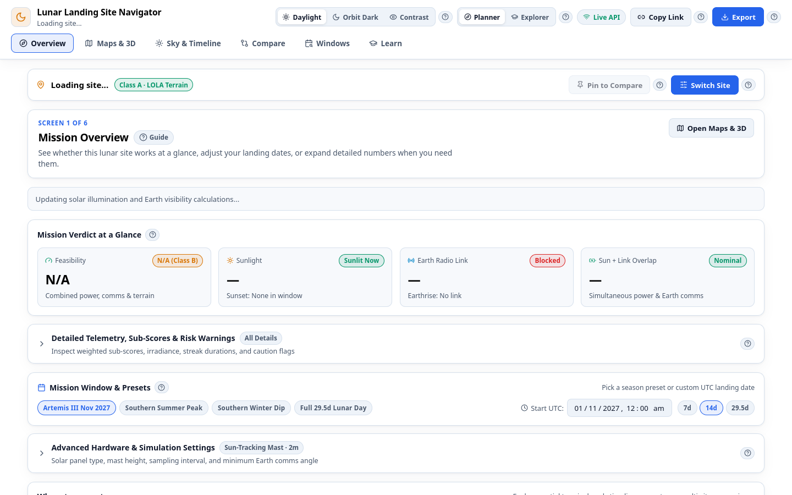

# Lunar Landing Site Navigator

**NASA Space Apps 2026 — "Lunar Trailblazer: Mission Planning for the South Pole"**

> Mission planners, educators, and the public need to compare lunar landing sites and dates fast — so we turn JPL Horizons ephemeris and NASA LOLA topography into an interactive cockpit that shows, at a glance, how the Sun and Earth sit relative to a site's horizon to size solar power and direct-to-Earth comms windows.



## What it does

- **Interactive site selection** across a curated registry of 16 notable landing sites (Artemis III South Pole candidates, CLPS commercial targets, Apollo and Chang'e-4 historic sites, Chandrayaan-3, and more).
- **Sun & Earth position visualization**: a 360° panoramic horizon silhouette (solid measured LOLA terrain profile vs. dashed geometric limb), a polar sky-dome, and a 2D South Pole stereographic map.
- **Power and communications assessment**: solar elevation, power factor, hours-to-sunset/sunrise, Earth clearance, direct-to-Earth (DTE) visibility, and countdowns — all computed from a closed physics model (no client-side physics).
- **Temporal dynamics**: a multi-day mission timeline you can scrub, with synchronized horizon/timeline views across a 29.5-day lunar cycle.
- **Side-by-side comparison**, landing-window finder, and launch-delay sensitivity tools for agile mission replanning.
- **3D `local_enu` terrain viewer** with grazing crater-shadow simulation for the nine terrain-backed sites.

## Architecture

- **Backend** (`backend/src/`) — Clean Architecture (domain → application → infrastructure → API). Pure Python physics (solar power, DTE comms, horizon raycasting, feasibility scoring) served by a thin FastAPI layer with the P0 endpoints: `GET /api/v1/health`, `GET /api/v1/sites`, `GET /api/v1/sites/{site_id}/terrain`, `POST /api/v1/evaluate`. No download client or network access at runtime — all data ships as committed packs.
- **Frontend** (`frontend/src/`) — React + TypeScript (strict) + Vite + Three.js, Zustand stores with shareable URL sync, multi-theme UI with six navigation screens and contextual help.
- **Shared contracts** (`contracts/`) — generated OpenAPI spec and synthetic-labeled fixtures shared by both sides.

## Quickstart

Requirements: **Python 3.12** (via `uv`) and **Bun**. No other package managers.

### Backend

```bash
cd backend
uv sync --python 3.12 --frozen
uv run --python 3.12 --frozen uvicorn src.api.main:app --port 8000
```

### Frontend

```bash
cd frontend
bun install --frozen-lockfile
bun run dev
```

Open http://localhost:5173. The Vite dev server proxies `/api` to the backend on port 8000.

### Quality gates

```bash
cd backend && uv run --python 3.12 --frozen pytest -v
cd backend && uv run --python 3.12 --frozen ruff check .
cd backend && uv run --python 3.12 --frozen mypy src tests
cd frontend && bun run typecheck && bun run lint && bun run test && bun run build
```

See [`docs/DEMO_SCRIPT.md`](docs/DEMO_SCRIPT.md) for a 3-minute guided walkthrough.

## Data resources

| Resource | Use |
|---|---|
| **NASA LRO LOLA** (`ldem_80s_80m`) | 80 m/pixel south-polar digital elevation model for terrain packs and horizon raycasting |
| **JPL Horizons** (`MOON_ME`) | Sun and Earth azimuth/elevation tracks for all 16 sites, 2026–2029 |
| **LRO QuickMap** | Site coordinate cross-checking and contextual imagery |
| **NASA Moon Trek** | Site coordinate cross-checking and contextual imagery |
| **CSA (Canadian Space Agency)** | Artemis partner context for mobility and robotics planning |

Coordinates are sourced with provenance; see [`docs/COORDINATE_SOURCING_GUIDE.md`](docs/COORDINATE_SOURCING_GUIDE.md).

## Terrain model — Class A vs. Class B (honest disclosure)

The `ldem_80s_80m` product covers the south polar region only. We classify sites honestly rather than fabricating topography:

- **Class A** (9 sites, all south-polar): a real 128 × 128 terrain patch with a 360° horizon profile, so the horizon silhouette reflects actual crater rims and ridge shadows. Terrain and feasibility scores are computed.
- **Class B** (7 sites, equatorial/far-side): no terrain model is available, so the UI shows **"Terrain model unavailable — spherical limb only"**, sets terrain and feasibility scores to `null`, and draws only the geometric limb. No topography is ever synthesized.

## License

MIT License.
